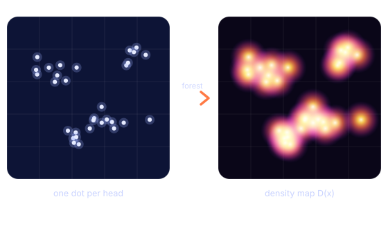
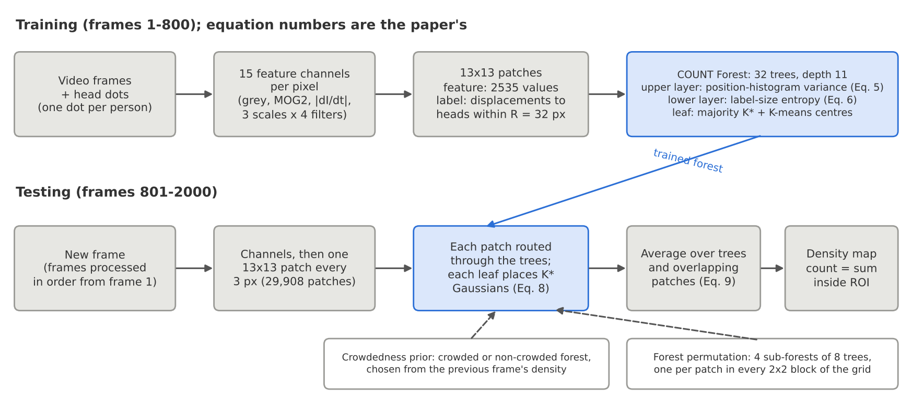
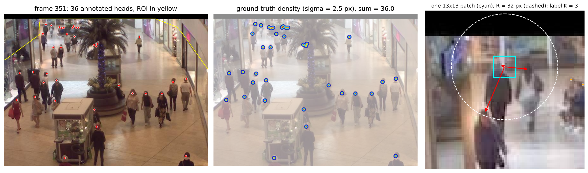
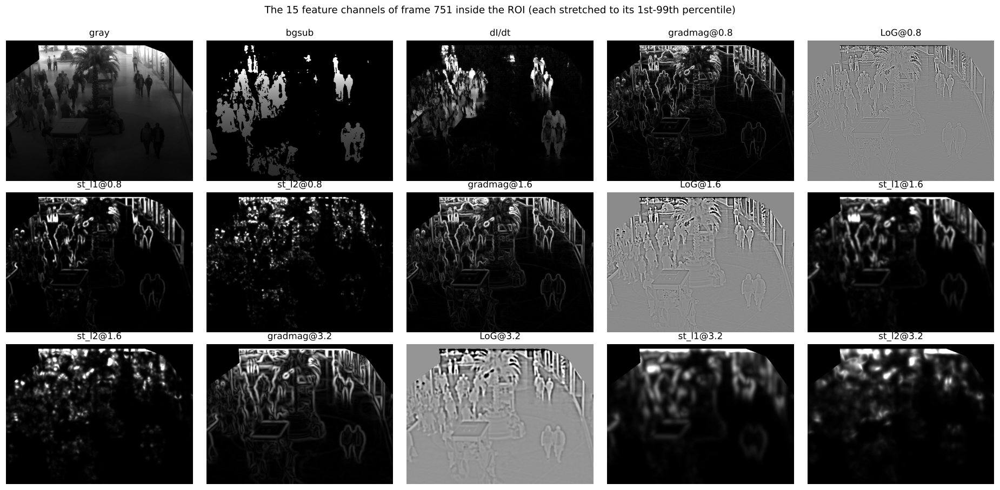
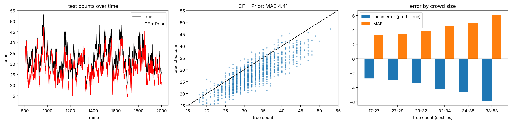
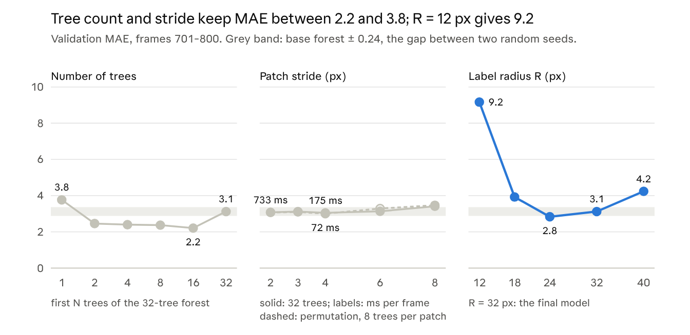
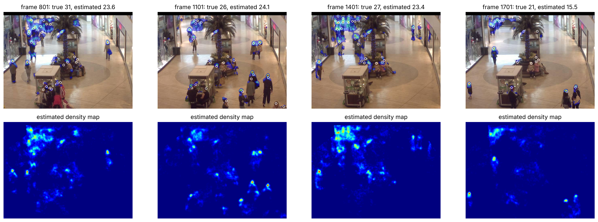
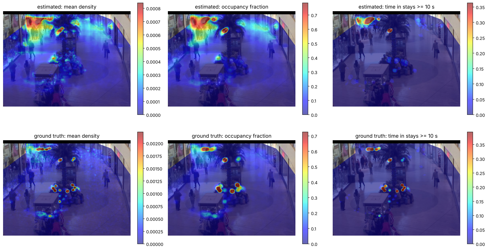
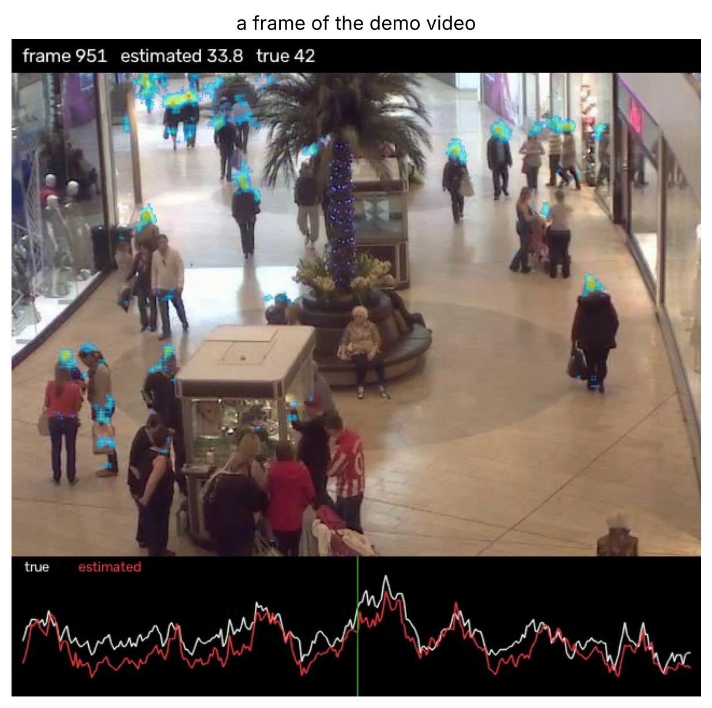
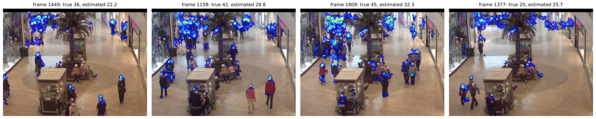

EE5340 Video Analytics · IIT Guwahati · November 2026

<h1 class="cf-title">COUNT Forest Crowd Counting</h1>

A from-scratch reimplementation of COUNT Forest (Pham et al., ICCV 2015), evaluated on the Mall dataset.

<i>NB</i>Naman Bhalawat<i>SZ</i>Siddhant Zawar<i>JC</i>Jalaj Chaudhary

[Watch the demo](#9-video-demonstration-and-screen-recording-of-ppt){ .cf-btn .cf-btn--primary }
[Slides (PPT)](#8-link-to-ppt-file-on-github){ .cf-btn }
[Code on GitHub](https://github.com/jalaj-chaudhary/count-forest-crowd-counting/blob/main/count_forest_full.ipynb){ .cf-btn }
[Setup & how to run](setup.md){ .cf-btn }

4.41Test MAE, best variant (paper: 2.50)

0.84Correlation of predicted and true counts

1.73 <small>MB</small>Model size (32 trees)

1.8×Speed-up from forest permutation

CPUNo GPU: forest written from scratch in NumPy

What is in this report

<a class="cf-card" href="#1-introduction">1<b>Introduction</b>Why count crowds, and what we add</a>
<a class="cf-card" href="#2-brief-literature-review">2<b>Literature review</b>From regression to density forests</a>
<a class="cf-card" href="#3-methodology">3<b>Methodology</b>Patches, two-layer trees, density maps</a>
<a class="cf-card" href="#4-experimental-setup">4<b>Experimental setup</b>Mall dataset, metrics, baselines</a>
<a class="cf-card" href="#5-results">5<b>Results</b>Accuracy, ablations, heat maps, failures</a>
<a class="cf-card" href="#6-conclusion">6<b>Conclusion</b>What we learned and what is next</a>
<a class="cf-card" href="#7-references">7<b>References</b>Papers and the dataset</a>
<a class="cf-card" href="#8-link-to-ppt-file-on-github">8<b>PPT on GitHub</b>Presentation slides on GitHub</a>
<a class="cf-card" href="#9-video-demonstration-and-screen-recording-of-ppt">9<b>Video</b>Demo clip and the recorded talk</a>

## 1. Introduction

### 1.1 Motivation

Knowing how many people are in a place at a given time matters for safety, staffing and planning, and counting them by hand does not scale to continuous video. Detecting each person and counting the detections breaks down in crowds, where people are small, overlap and hide each other. Density estimation avoids detection: a model predicts a **density map** whose total over any region is the number of people in it.

COUNT Forest (Pham et al., ICCV 2015) is one such method. It uses a random forest, so the model is small (1.7 MB here) and runs on a CPU. Its density maps also give a heat map and a stationary-time estimate.

### 1.2 Applications

- **Crowd monitoring.** The occupancy of a hall, street or mall from a fixed camera, for example to raise an alert when the count passes a limit.
- **Retail and facility planning.** Where people gather and how long they stay, from the heat map and stationary-time maps shown in [section 5.3](#53-qualitative-results-and-applications).
- **Surveillance and traffic.** The paper lists traffic control, surveillance, industrial inspection and medical image analysis as uses of counting, and names crowd behaviour in public spaces such as train stations and streets.
- **Other objects.** Density estimation learned from dot annotations alone was first shown on counting cells in microscope images [6].

### 1.3 Problem statement

The setting is a fixed camera with a known perspective map and region of interest (ROI), plus training frames in which every head is marked by one dot. For each new frame, the task is to estimate:

1. the number of people inside the ROI;
2. a density map \(D(x) \ge 0\) whose sum over any region is the number of people there.

The count of frame \(t\) is the sum of \(D_t(x)\) over the ROI. Quality is measured by the mean absolute error (MAE), the mean squared error (MSE) and the mean deviation error (MDE) over the test frames ([section 4.1](#41-dataset-protocol-and-metrics)). The method should run on a CPU with a small model.

### 1.4 Contributions

We reimplemented COUNT Forest from the paper's description, then trained and tested it on the Mall dataset with the paper's split (frames 1–800 for training, 801–2000 for testing). The project contributes:

- **A complete implementation in Python.** It covers the feature channels, two-layer tree training, the leaf model, density estimation, the crowdedness prior and forest permutation. Its fast tree-routing estimator matches a straightforward version to within \(10^{-9}\) and is about seven times faster (0.38 s against 2.9 s for one frame, one run).
- **Test results for four variants of the method**, with the paper's own figures quoted for reference ([section 5.1](#51-quantitative-results-on-the-test-set)).
- **Ablation studies on a validation block**, with an estimate of the noise between two random seeds ([section 5.2](#52-ablations)).
- **Applications and failure analysis:** a heat-map and stationary-time application, a demo video ([section 5.3](#53-qualitative-results-and-applications)) and an analysis of failure cases ([section 5.5](#55-failure-cases)).

---

## 2. Brief literature review

**Counting by regression.** Early crowd counting avoided detecting people. Chan, Liang and Vasconcelos [5] segment the crowd into components of homogeneous motion and regress the count from their features, without segmenting or tracking individuals. Their pedestrian dataset (UCSD, 2000 frames) is still a standard benchmark. Chen et al. [2] introduced the Mall dataset together with a feature-mining approach to localised counting, and cumulative attribute learning [3] was applied to counting as well.

**Density estimation.** Lempitsky and Zisserman [6] cast counting as estimating an image density whose integral over any region gives the count, learned from dot annotations only. Fiaschi et al. [7] predict that density with a regression forest that maps feature patches to patches of target density and averages the overlapping predictions. Storing dense density patches in the leaves takes a lot of memory. COUNT Forest [1] differs in four ways:

- its leaves store the number and the positions of the heads in a patch instead;
- each tree is built with two split layers, coarse then fine;
- it adds a crowdedness prior and a forest-reduction scheme based on permuting trees;
- it offers a semi-automatic way to train a scene-specific model.

The paper reports state-of-the-art results on Mall and UCSD at the time of publication.

**Deep learning.** Since 2016, convolutional networks have dominated the benchmarks. The multi-column network of Zhang et al. [8] maps an image to a density map with filters of several sizes to cope with changing head size. CSRNet [9] uses a convolutional front end with a dilated back end in place of pooling. A survey of the field is given in [4]. COUNT Forest is a classical, non-deep method with a small model that runs on a CPU. This project reimplements the forest method only and, by its scope, does not compare it with these methods.

---

## 3. Methodology

COUNT Forest predicts, for every 13×13 image patch, where the heads near that patch are, then sums Gaussians placed at those positions into a density map. The count of a frame is the sum of its density map inside the ROI. Figure 1 shows the pipeline. The equation numbers in the figure are those of the paper, and the sections below follow the same order.

<figure markdown>

<figcaption>Figure 1. Pipeline. Training (top) uses frames 1–800 with one dot per head. Testing (bottom) processes frames 801–2000 in order. The blue boxes are the forest and its use; the two dashed boxes are the optional additions, the crowdedness prior and forest permutation.</figcaption>
</figure>

### 3.1 Density map and patch labels

Let \(P_t\) be the annotated head positions of frame \(t\). The ground-truth density puts a normalised Gaussian (\(\sigma = 2.5\) px) on every head, so it sums to the head count:

$$
D^{gt}_t(x)=\sum_{p\in P_t}\mathcal{N}(x;p,\sigma^2 I),\qquad
\mathcal{N}(x;\mu,\sigma^2 I)=\frac{1}{2\pi\sigma^2}\exp\Big(-\frac{\lVert x-\mu\rVert^2}{2\sigma^2}\Big)
$$

A training sample is a patch with centre \(c\), a feature vector ([section 3.2](#32-patch-features)) and a label. The label is the set of displacement vectors from \(c\) to every head closer than \(R = 32\) px, and its size \(K\) is the number of those heads:

$$
L(c)=\{\,p-c\;:\;p\in P_t,\ \lVert p-c\rVert<R\,\},\qquad K=|L(c)|
$$

Most patches have no head in range: in the tuning pool, 78% of the sampled training patches have \(K = 0\). Figure 2 shows a frame, its density and one label.

<figure markdown>

<figcaption>Figure 2. Left: frame 351 with its 36 annotated heads (red) and the ROI (yellow). Centre: the ground-truth density (σ = 2.5 px), which sums to 36.0. Right: one 13×13 patch (cyan) and its label; the heads inside the dashed circle of radius R = 32 px give K = 3, drawn as the red displacement vectors from the patch centre.</figcaption>
</figure>

### 3.2 Patch features

Every frame is turned into 15 channels:

- **Three simple channels:** the grey image, the foreground mask of an OpenCV MOG2 background model, and the absolute difference to the previous frame.
- **Twelve multi-scale channels,** computed at three scales \(s = 0.8, 1.6, 3.2\):
    - the Gaussian gradient magnitude;
    - the Laplacian of Gaussian (LoG);
    - the two eigenvalues of the structure tensor, whose derivatives \(I_x, I_y\) are taken at scale \(s\) and whose products are smoothed at scale \(2s\).

$$
C_1=I/255,\qquad C_2=\mathrm{FG}_{\mathrm{MOG2}},\qquad C_3=|I_t-I_{t-1}|
$$

$$
C^{\mathrm{grad}}_s=\lVert\nabla(G_s*I)\rVert,\qquad
C^{\mathrm{LoG}}_s=\Delta(G_s*I),\qquad s\in\{0.8,\,1.6,\,3.2\}
$$

$$
J_s=G_{2s}*\begin{pmatrix}I_x^2&I_xI_y\\ I_xI_y&I_y^2\end{pmatrix},\qquad
\lambda_{\pm,s}=\frac{J_{xx}+J_{yy}}{2}\pm\sqrt{\Big(\frac{J_{xx}-J_{yy}}{2}\Big)^2+J_{xy}^2}
$$

Each channel is multiplied by the perspective map \(M(x)\) of the scene. The feature of a patch is its 13×13 window in all 15 channels, 2535 values:

$$
f(c)=\big(M(x)\,C_k(x)\big)_{k=1,\dots,15;\;x\in W(c)}\ \in\ \mathbb{R}^{15\cdot13\cdot13=2535}
$$

The background model and the temporal difference need the frames in order, so channels are computed by streaming the video from frame 1. Figure 3 shows the 15 channels for one frame. In the ablations ([section 5.2](#52-ablations)), removing the temporal channels, the structure-tensor channels or the two coarser scales each costs more than the seed noise.

<figure markdown>

<figcaption>Figure 3. The 15 channels of frame 751 inside the ROI, each stretched to its 1st to 99th percentile for display. Names follow the code: st_l1 and st_l2 are the larger and the smaller structure-tensor eigenvalue, and the number after @ is the scale.</figcaption>
</figure>

### 3.3 Tree training: two split layers

Each tree is trained on a random sample of 100,000 patches from the training pool. At a node holding the sample set \(S\), 256 candidate splits are drawn at random. Each candidate is a feature index \(j\) and a threshold \(\theta\), equal to the value of that feature in a random sample of the node. A candidate sends the samples with \(f[j] < \theta\) to the left child \(S_L\) and the rest to \(S_R\). It is discarded if either child has fewer than 5 samples. The best remaining candidate is used; what "best" means depends on the depth.

**Upper layer** (the paper's Eq. 5). This criterion applies below depth 8 at nodes of at least 40 samples; smaller nodes use the lower criterion. The label of a sample is turned into a soft 2-D histogram of its head positions over 5×5 bins covering \([-R, R]^2\). A split minimises the variance of these histograms inside the two children:

$$
H_i(b)=\sum_{v\in L_i}\exp\Big(-\frac{\lVert v-m_b\rVert^2}{2\sigma_H^2}\Big),\qquad
\min_{(j,\theta)}\ \sum_{c\in\{L,R\}}\ \sum_{i\in S_c}\lVert H_i-\bar H_c\rVert^2,\quad
\bar H_c=\frac{1}{|S_c|}\sum_{i\in S_c}H_i
$$

Here \(m_b\) is the centre of bin \(b\) and \(\sigma_H\) is one bin width (\(2R/5 = 12.8\) px). This layer groups patches whose heads lie in similar places.

**Lower layer** (the paper's Eq. 6). It applies at the remaining depths. A split minimises the size-weighted entropy of the label sizes \(K\) in the two children, which makes each leaf agree on how many heads there are:

$$
\min_{(j,\theta)}\ |S_L|\,H(K\mid S_L)+|S_R|\,H(K\mid S_R),\qquad H(K\mid S)=-\sum_k p_S(k)\log_2 p_S(k)
$$

A node becomes a leaf in any of these cases:

- it is at depth 11;
- it has fewer than 20 samples;
- all its samples have the same \(K\);
- no candidate split is valid.

### 3.4 Leaf model

A leaf \(\ell\) stores the most common label size \(K^*_\ell\) among its samples (the smaller \(K\) if there is a tie). It also stores \(K^*_\ell\) cluster centres, found by K-means on the displacement vectors of the samples that have that label size. A leaf with \(K^* = 0\) stores nothing and votes for no head.

$$
K^*_\ell=\arg\max_k\,\big|\{i\in\ell:\ K_i=k\}\big|,\qquad
\{\mu_{\ell 1},\dots,\mu_{\ell K^*_\ell}\}=\mathrm{KMeans}_{K^*_\ell}\big(\{v\in L_i:\ i\in\ell,\ K_i=K^*_\ell\}\big)
$$

### 3.5 Density estimation

At test time a patch is taken every 3 px (29,908 patches per frame). The density is built in three steps:

1. **Per tree:** each patch is routed through the trees. In every tree, its leaf places \(K^*\) Gaussians at the stored displacements from the patch centre.
2. **Per patch:** the Gaussians of the trees are averaged to give the density \(D_i\) of the patch on its own 13×13 window \(W_i\) (the paper's Eq. 7 and 8).
3. **Per pixel:** the densities of all patches that cover a pixel are averaged (Eq. 9), and the count is the sum over the ROI.

$$
D_i(x)=\frac{1}{|T|}\sum_{T_j\in T}\ \sum_{k=1}^{K^*_j(i)}\mathcal{N}\big(x;\,c_i+\mu_{jk}(i),\,\sigma^2 I\big),\quad x\in W_i
$$

$$
D(x)=\frac{1}{|\mathcal{P}(x)|}\sum_{i\in\mathcal{P}(x)}D_i(x),\qquad \hat N=\sum_{x\in\mathrm{ROI}}D(x)
$$

Here \(K^*_j(i)\) and \(\mu_{jk}(i)\) are the values stored in the leaf of tree \(T_j\) that patch \(i\) reaches, and \(\mathcal{P}(x)\) is the set of patches whose window contains \(x\). A faster routine reads the split features straight from the channel stack. It gives the same density as the direct version to within \(10^{-9}\) and is about seven times faster.

### 3.6 Crowdedness prior

Two forests are trained:

- \(F_c\) on crowded patches (\(K\) between \(N/3\) and \(N\));
- \(F_n\) on non-crowded patches (\(K\) up to \(2N/3\)).

A patch of frame \(t\) uses \(F_c\) if the density that the previous frame placed within \(R\) pixels of it exceeds \(N/2\) heads, and \(F_n\) otherwise. The first frame uses the plain forest. We use \(N = 6\); the paper takes \(N\) as the largest label size, which is 9 on this data. Only one forest runs per patch, so the running time does not change, but two forests are stored (3.19 MB against 1.73 MB).

$$
F(i,t)=\begin{cases}F_{\mathrm{c}}&\text{if }\sum_{\lVert x-c_i\rVert<R}D_{t-1}(x)>N/2\\[2pt] F_{\mathrm{n}}&\text{otherwise}\end{cases}
$$

### 3.7 Forest permutation

The 32 trees are split into 4 sub-forests \(T_0\) to \(T_3\) of 8 trees. A patch at grid position \((g_x, g_y)\) is predicted by one sub-forest \(s\) only, so any 2×2 block of neighbouring patches uses all four. Each patch costs a quarter of the tree evaluations, while each pixel still averages over patches from the whole forest.

$$
s(g_x,g_y)=2\,(g_y \bmod 2)+(g_x \bmod 2),\qquad D_i \text{ is computed with } T_{s(i)} \text{ in place of } T
$$

### 3.8 Heat map and stationary time

The estimated density maps \(D_t\) of the test video give the paper's second application without further training:

- **Occupied pixel:** a pixel is occupied in frame \(t\) if the density within 8 px of it exceeds a threshold \(\tau\). Taking the maximum over that small disk allows for local movement.
- **Stay:** a run of consecutive occupied frames.
- **Long stay:** a stay of at least 10 s (20 frames at 2 frames per second).

The outputs are the heat map \(H\), the fraction of time occupied \(A\), and the fraction of time spent in long stays \(L\):

$$
O_t(x)=\mathbb{1}\Big[\max_{\lVert y-x\rVert\le 8}D_t(y)>\tau\Big],\quad
H(x)=\frac1T\sum_t D_t(x),\quad
A(x)=\frac1T\sum_t O_t(x),\quad
L(x)=\frac1T\sum_{e\ni x,\ |e|\ge 20}|e|
$$

Here \(e\) runs over the stays at \(x\) and \(|e|\) is a stay's length in frames.

### 3.9 Settings the paper leaves open

The paper fixes the forest's size and the feature set but leaves several settings open. Where it is silent we chose a value, and we tuned the important ones on validation frames (Mall frames 701–800, training on 1–700). The most consequential is the label radius \(R\), which the paper does not give: across \(R\) = 12 to 40 px the validation MAE ranges from 2.8 to 9.2 ([section 5.2](#52-ablations)).

| Setting | Paper | This implementation |
|---|---|---|
| Trees, depth, upper-layer depth, minimum node size | 32, 11, 8, 20 | the same |
| Patch size | 13×13 | the same |
| Training patches per frame | 1000 | 300 (to fit in 7 GB of memory) |
| Label radius \(R\) | not given | 32 px |
| Head-position histogram (upper layer) | a 2-D histogram | 5×5 bins, each head spread by a Gaussian one bin wide |
| Split candidates per node | not given | 256 random (feature, threshold) pairs; the best is used |
| Smallest allowed child; smallest node for the upper layer | not given | 5 samples; 40 samples |
| Training sample of a tree | not described | a random 100,000 of the pooled patches (210,000 pooled when tuning, 240,000 for the final model) |
| Perspective weighting | features × (perspective map)² | features × perspective map (Mall's map is already an area scale; compared in section 5.2) |
| Background subtraction | "the background subtraction result" | OpenCV MOG2, history 500, median-filtered mask |
| Patch grid at test time | not given | one patch every 3 px (29,908 per frame) |
| Prior threshold \(N\) | max label size (9 here) | 6 |
| First frame under the prior | not stated | the plain forest |

---

## 4. Experimental setup

### 4.1 Dataset, protocol and metrics

All results are on the Mall dataset, with the same split as the paper: the first 800 frames for training and the remaining 1200 for testing.

- **Dataset.** 2000 frames of 640×480 at 2 frames per second, from a shopping mall camera (Chen et al. [2]). Between 13 and 53 people are inside the ROI in every frame. Heads are annotated as dots, and the dataset provides the ROI and a perspective map.
- **Tuning protocol.** Settings were chosen by training on frames 1–700 and scoring frames 701–800. We used a contiguous block because neighbouring frames are almost identical. The final model was then trained on all 800 training frames. The test frames were run once, after the settings were fixed.
- **Metrics.** For true counts \(\kappa\) and estimates \(\hat\kappa\) over the evaluated frames, the estimate of a frame is the sum of its density map inside the ROI, and:

$$
\mathrm{MAE}=\overline{|\kappa-\hat\kappa|},\qquad
\mathrm{MSE}=\overline{(\kappa-\hat\kappa)^2}\ \ (\text{no square root, as in the paper}),\qquad
\mathrm{MDE}=\overline{|\kappa-\hat\kappa|/\kappa}
$$

### 4.2 Baseline algorithms

As decided for this project, COUNT Forest is the only method implemented, and it is not compared with other counting methods. The baseline for the experiments is therefore the **plain COUNT Forest (CF)**: 32 trees with the two split layers and no extra component.

- **Variants.** Three variants add the paper's two components to the baseline: CF + forest permutation, CF + crowdedness prior, and both together.
- **Ablations.** The ablations in section 5.2 change one setting of the plain forest at a time.
- **Reference point.** The paper's own result for its full method on Mall (MAE 2.50, MSE 10.0, MDE 0.080, its Table 2) is quoted for reference and was not re-run.

### 4.3 Implementation platform

| | |
|---|---|
| **Language & libraries** | Python 3.13, NumPy 2.5, SciPy 1.18, OpenCV 5.0 (MOG2 and filtering), joblib (parallel tree training, model storage), Matplotlib |
| **From scratch** | The forest, its training and the density estimator use no random-forest or deep-learning library |
| **Hardware** | One machine, 2 CPU cores, 7 GB of memory |
| **Training cost** | Training pool for 800 frames: 192 s. Training 32 trees: 100 s |
| **Model size** | 1.73 MB (the paper: 1.5 MB) |
| **Inference cost** | 360 ms per frame (plain forest), 195 ms per frame (forest permutation), plus about 190 ms per frame of channel extraction |
| **Code** | One Jupyter notebook, [`count_forest_full.ipynb`](https://github.com/jalaj-chaudhary/count-forest-crowd-counting/blob/main/count_forest_full.ipynb) |

---

## 5. Results

### 5.1 Quantitative results on the test set

On the 1200 test frames (801–2000), the four estimator variants reach MAE 4.41 to 4.46, against 2.50 for the full method in the paper. Every variant counts too low by about 13%.

| Variant | MAE | MSE | MDE | Trees per patch | Model size (MB) | Estimation (ms/frame) |
|---|---|---|---|---|---|---|
| COUNT Forest (CF) | 4.438 | 27.71 | 0.137 | 32 | 1.73 | 360 |
| CF + forest permutation | 4.460 | 27.91 | 0.137 | 8 | 1.73 | **195** |
| CF + crowdedness prior (N = 6) | **4.412** | **27.46** | **0.136** | 32 | 3.19 | 367 |
| CF + prior + permutation | 4.451 | 27.92 | 0.137 | 8 | 3.19 | 202 |
| *Paper, full method (quoted, not re-run)* | *2.50* | *10.0* | *0.080* | | *1.5* | |

Estimation time excludes about 190 ms per frame of channel extraction.

<figure markdown>

<figcaption>Figure 4. Test frames 801–2000, CF + prior (the variant with the lowest MAE): true and estimated counts over time (left), estimated against true count (centre), and mean error and MAE by sextile of the true count (right).</figcaption>
</figure>

- **The error is mostly a constant undercount.** The mean predicted count is 28.1 against a true mean of 32.2. The mean error is −4.1, and the correlation between predicted and true counts is 0.84. Subtracting the mean error would leave an MAE of 2.7. This is a diagnostic computed with the test labels, not a result.
- **It grows with crowd size.** The predicted-to-true ratio falls from 0.89 for the least crowded quarter of frames to 0.86 for the most crowded. All eight consecutive blocks of the test period are undercounted.
- **It is larger than on validation.** On validation frames 701–800 the same forest scored MAE 3.12 with a 7% undercount.
- **Permutation and prior.** Forest permutation cut estimation time from 360 to 195 ms per frame (1.8 times faster) and changed MAE by 0.02. The crowdedness prior changed MAE by −0.03 and nearly doubled the model size. Two forests that differ only in the random seed differ by 0.24 MAE on validation, so differences of 0.02 to 0.03 can't be told apart from noise.

### 5.2 Ablations

All ablations train on frames 1–700 and score frames 701–800; no test frame is used. Each run changes one setting of the tuned configuration: a plain forest of 32 trees, patch stride 3, \(R\) = 32 px, 300 training patches per frame, no prior. The true mean count of the validation block is 35.8 people.

Two forests that differ only in the random seed score MAE 3.12 and 3.37, so we treat differences below about 0.25 as indistinguishable. Two runs give only a rough scale for this, not a confidence interval. The final model and the test results were fixed before these runs, and none of them was changed afterwards.

<figure markdown>

<figcaption>Figure 5. Ablations on validation frames 701–800, trained on frames 1–700: number of trees, patch stride (with and without forest permutation) and label radius R.</figcaption>
</figure>

- **Trees.** These are the first N trees of one forest.
    - A single tree is clearly worse (MAE 3.77).
    - With 2 to 16 trees, the MAE is 2.2 to 2.5 and the mean count is 34.8 to 35.9, close to the true 35.8.
    - With all 32 trees, the MAE is 3.12 and the mean count 33.2.

    So more trees did not help on this block: the second sixteen lower the mean count by about two people.
- **Stride.** The error is flat from stride 2 to 6 and rises at stride 8 (3.41). Cost falls from 733 ms to 175 ms per frame between stride 2 and 4. At stride 4, forest permutation gives MAE 3.00 in 72 ms, about four times faster than the stride-3 setting used for the main results (MAE 3.12, 302 ms).
- **Label radius \(R\).** \(R\) = 12 undercounts severely (mean count 26.6), and \(R\) = 18 overcounts (38.7, MAE 3.93). \(R\) = 24 has the lowest MAE of the sweep (2.84, mean count 36.5), beating our choice of 32 by 0.29, about the size of the seed gap.

**Retraining ablations.** These runs train a new forest on frames 1–700 with one change each.

| Change from the base forest | MAE | MSE | MDE | Mean count |
|---|---|---|---|---|
| None (base) | 3.12 | 13.5 | 0.089 | 33.2 |
| Another random seed | 3.37 | 15.8 | 0.096 | 32.9 |
| Lower split layer (label-size entropy) at every depth | 2.87 | 13.1 | 0.079 | 37.4 |
| Upper split layer (position variance) at every depth | 8.31 | 75.8 | 0.236 | 27.5 |
| Without the two temporal channels (13 channels) | 6.32 | 54.4 | 0.165 | 29.5 |
| Without the six structure-tensor channels (9 channels) | 8.67 | 82.9 | 0.245 | 27.1 |
| Finest scale only (7 channels) | 5.34 | 35.1 | 0.153 | 30.6 |
| Channels × (perspective map)², as in the paper | 2.92 | 13.2 | 0.083 | 37.6 |
| 100 training patches per frame instead of 300 | 2.68 | 10.6 | 0.076 | 34.0 |

- **Split layers.** Using only the label-size entropy criterion scores 2.87, no worse than the paper's two-layer design once the noise is allowed for. So this block gives no support for the position-variance upper layer. Using the position-variance criterion at every depth is much worse (8.31).
- **Feature channels.** Every group removed costs far more than the noise. All three reduced feature sets also count lower (27 to 31 people against a true 35.8).
- **Perspective weighting.** The squared perspective map scores 2.92 against 3.12, a difference inside the noise. The squared version counts about 4 people more.
- **Training patches.** 100 patches per frame score 2.68, no worse than 300.

Several variants score 0.2 to 0.9 below the base MAE: 2 to 16 trees, the lower layer alone, \(R\) = 24, squared perspective weighting, and 100 patches per frame. Each of them also counts more people than the base forest. That fits the test-set finding that most of the error is the overall level of the count. But each comparison is one run on 100 neighbouring frames, so none of them is a tuned result, and none was applied to the final model.

### 5.3 Qualitative results and applications

**Density maps.** Figure 6 shows the estimated density on four test frames.

- Isolated people get compact peaks at the head.
- Where people stand close together, as in the upper left, the density is a broader blob.
- The group sitting on the bench by the palm planter gets weak density.

All four frames are counted too low (estimated 15.5 to 24.1 against a true 21 to 31).

<figure markdown>

<figcaption>Figure 6. Four test frames, same variant as Figure 4. Top: the estimated density drawn where it exceeds 10% of the frame's peak, with the annotated heads as white circles. Bottom: the estimated density map.</figcaption>
</figure>

**Heat map and stationary time.** The density maps of the test video give a heat map and a stationary-time estimate (the paper's second application) with no further training.

<figure markdown>

<figcaption>Figure 7. Maps from the CF + permutation density maps of the 1200 test frames (top) and from the annotated heads (bottom): mean density, fraction of time occupied, and fraction of time spent in stays of at least 10 s.</figcaption>
</figure>

- **Method.** The definitions are in [section 3.8](#38-heat-map-and-stationary-time). The threshold for the estimated maps (0.0012, about a third of the peak density of one estimated person) is our choice. The reference maps use the same rule on a Gaussian placed on each annotated head.
- **Agreement with the annotations.** After a light blur, the maps correlate with the annotation maps at:
    - 0.66 for the mean-density heat map;
    - 0.68 for the fraction of time a pixel is occupied;
    - 0.58 for the fraction of time it spends in stays of at least 10 s.
- **What the maps get right.** They find the busy upper-left area of the scene and the bench seat under the palm tree's upper branches.
- **What they miss.** The benches in the lower middle, where several people sit close together and partly hidden, do not appear as long stays. The model undercounts dense, occluded clusters, so those pixels never reach the threshold. The upper-left blob is also wider than in the annotations, because people far from the camera give lower, more spread-out peaks.

**Demo video.** [`demo_counting.mp4`](assets/video/demo_counting.mp4) shows the first 300 test frames with the density overlay, the estimated and true counts, and the count curve so far ([section 9](#9-video-demonstration-and-screen-recording-of-ppt)).

<figure markdown>
{ width="640" }
<figcaption>Figure 8. Frame 951 of the demo video: estimated and true counts, and the count curves of the first 300 test frames with the current frame marked in green.</figcaption>
</figure>

### 5.4 Discussion

This reimplementation does not reach the paper's accuracy. On the 1200 test frames the MAE is 4.41 to 4.46, against 2.50 for the paper's full method (quoted from its Table 2, not re-run). The estimates follow the true counts well (correlation 0.84) but sit about 4 people, or 13%, too low. Removing that offset would leave an MAE of about 2.7, a diagnostic computed with the test labels and not a result. We have not yet tested the cause of the undercount, and this report does not claim one. Factors that could play a part, none of them tested yet:

- **Training patches.** We used 300 per frame where the paper used 1000. The ablations found no gain from 300 over 100, which makes this a weak candidate.
- **Label radius \(R\).** The paper does not give \(R\). We set it on a single 100-frame validation block, and the error depends strongly on it (2.8 to 9.2 across \(R\) = 12 to 40).
- **Crowd level.** The mean true count is 28.7 in frames 1–700, 35.8 in the validation block and 32.2 in the test frames; the final model's 800 training frames average 29.5. Whether this affects the leaf models was not examined.
- **Leaf rule.** A leaf keeps its most common label size, and 62% of the final forest's leaves have a label size of zero. Whether this biases counts low was not examined.

**Validation and test.** The base forest scored MAE 3.12 on validation and the same kind of forest 4.44 on test, so the 100-frame validation block was too optimistic. It is a small sample of nearly identical neighbouring frames, and the noise estimate of 0.24 comes from only two forests.

**Permutation and prior.** Forest permutation made estimation 1.8 times faster for a 0.02 change in MAE. The paper reports a similar speed-up on UCSD (98 ms to 36 ms with the prior in both, its Table 4). The crowdedness prior changed MAE by −0.03, below the seed noise, and almost doubled the model size. So these experiments do not confirm an accuracy gain from it.

### 5.5 Failure cases

The main failure is the undercount described above. Figure 9 shows the three test frames with the largest undercount (chosen at least 100 frames apart) and the one with the largest overcount. These frames were picked for their error, so they show failures and not typical frames; Figures 4 and 6 show typical ones.

<figure markdown>

<figcaption>Figure 9. Failure cases, CF + forest permutation. Frames 1449, 1158 and 1809 are the largest undercounts, chosen at least 100 frames apart (−13.8, −13.2 and −12.7 people); frame 1377 is the largest overcount (+5.7). The estimated density is drawn where it exceeds 10% of the frame's peak, and the white circles are the annotated heads.</figcaption>
</figure>

- **The undercount is the main failure.** 89% of the 1200 test frames are counted too low. In 11% of the frames the count is off by more than 8 people, and every one of those is an undercount. The largest overcount is 5.7 people.
- **Dense groups in the upper left.** In the three undercounted frames, many annotated heads sit close together in the upper left under one broad blob of density. The frame totals fall 12.7 to 13.8 people short.
- **Seated people.** In frame 1449, the group sitting on the bench by the palm planter gets almost no density, although several heads are annotated there. The stationary-time maps also miss long stays by seated groups.
- **Overcount.** In frame 1377 (true 20, estimated 25.7), there are density blobs along the top edge and in the upper right, where few heads are annotated.

---

## 6. Conclusion

### 6.1 Summary

We reimplemented COUNT Forest (Pham et al., ICCV 2015) from the paper's description and evaluated it on the Mall dataset with the paper's split. The implementation covers:

- the 15-channel patch features;
- the two-layer trees with their leaf model;
- density estimation;
- the crowdedness prior and forest permutation;
- the stationary-time application.

On the 1200 test frames it reaches MAE 4.41 to 4.46, MSE 27.5 to 27.9 and MDE 0.136 to 0.137, against 2.50, 10.0 and 0.080 quoted for the paper's full method. The paper's accuracy was not reproduced. The estimated counts follow the true counts (correlation 0.84) but are about 13% too low.

Forest permutation made density estimation 1.8 times faster with no measurable change in accuracy, and the crowdedness prior changed the error by less than the seed noise. In the ablations, the feature channels, the split criteria and the label radius \(R\) mattered most. Heat maps and stationary-time maps built from the estimated density correlate 0.58 to 0.68 with maps built from the annotations.

### 6.2 Future work

**Outside this work:**

- The semi-automatic training with GrabCut person masks needs the PETS2009 images, and the UCSD experiments need that dataset; neither was available here.
- There is no comparison with other counting methods, by the design of the project.
- The test frames were run once, with one training seed.

**Next steps:**

- Test the factors listed in section 5.4 one at a time on validation (patches per frame, \(R\) between 20 and 28 px, the leaf rule), with several seeds per setting so that the noise is measured instead of assumed.
- Tune on several validation blocks spread over the sequence rather than one contiguous block. Run the variants that scored better on validation on the test frames, with several seeds.
- Add the GrabCut-based synthetic training data once the PETS2009 images are available, and run the method on UCSD.
- Compare the stationary-time maps with an independent measure of how long people stayed.

---

## 7. References

1. V.-Q. Pham, T. Kozakaya, O. Yamaguchi, R. Okada. *COUNT Forest: CO-voting Uncertain Number of Targets using Random Forest for Crowd Density Estimation.* ICCV 2015.
2. K. Chen, C. C. Loy, S. Gong, T. Xiang. *Feature mining for localised crowd counting.* BMVC 2012 (the Mall dataset).
3. K. Chen, S. Gong, T. Xiang, C. C. Loy. *Cumulative attribute space for age and crowd density estimation.* CVPR 2013.
4. M. Wang, X. Zhou, Y. Chen. *A comprehensive survey of crowd density estimation and counting.* IET Image Processing, 2025. [doi:10.1049/ipr2.13328](https://doi.org/10.1049/ipr2.13328)
5. A. B. Chan, Z.-S. J. Liang, N. Vasconcelos. *Privacy preserving crowd monitoring: Counting people without people models or tracking.* CVPR 2008.
6. V. Lempitsky, A. Zisserman. *Learning to count objects in images.* NIPS 2010.
7. L. Fiaschi, R. Nair, U. Köthe, F. A. Hamprecht. *Learning to count with regression forest and structured labels.* ICPR 2012.
8. Y. Zhang, D. Zhou, S. Chen, S. Gao, Y. Ma. *Single-image crowd counting via multi-column convolutional neural network.* CVPR 2016.
9. Y. Li, X. Zhang, D. Chen. *CSRNet: Dilated convolutional neural networks for understanding the highly congested scenes.* CVPR 2018.

---

## 8. Link to PPT file (on GitHub)

**PPT:** [COUNT_Forest_presentation.pptx](https://github.com/jalaj-chaudhary/count-forest-crowd-counting/blob/main/ppt/COUNT_Forest_presentation.pptx)

**Code:** [count_forest_full.ipynb](https://github.com/jalaj-chaudhary/count-forest-crowd-counting/blob/main/count_forest_full.ipynb)

---

## 9. Video demonstration and screen recording of PPT

### Video demonstration

The demo shows the first 300 test frames with the density overlay, the estimated and true counts, and the count curve so far.

<video controls preload="metadata" poster="assets/img/fig8_demo_frame.png" style="width:100%;max-width:640px;border-radius:8px;display:block;margin:1em auto;">
  <source src="assets/video/demo_counting.mp4" type="video/mp4">
  Your browser cannot play this video. <a href="assets/video/demo_counting.mp4">Download demo_counting.mp4</a>.
</video>

[Download demo_counting.mp4](assets/video/demo_counting.mp4) (37 s, 5 MB)

### Screen recording of the PPT

<iframe src="https://www.youtube.com/embed/1dfTp4FRBaE" title="COUNT Forest presentation" allowfullscreen></iframe>

[Watch on YouTube](https://www.youtube.com/watch?v=1dfTp4FRBaE)
